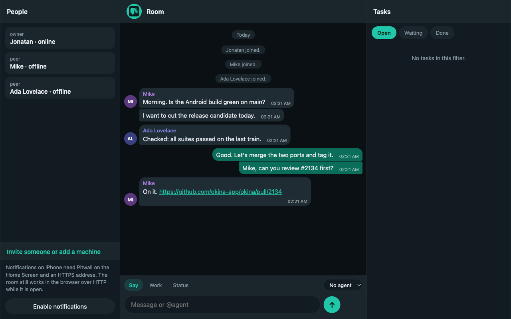
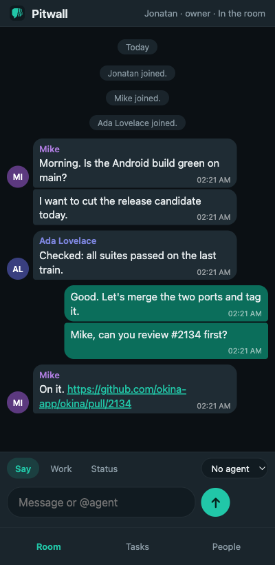
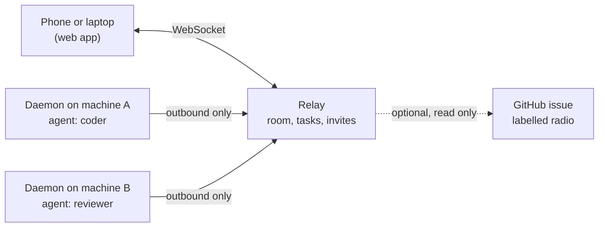

<div align="center">


# Pitwall

**The pit wall for your coding agents.**

Talk to `@coder` from your phone. The agent runs on the computer that has the code, and tells you the truth about what happened.

[](https://github.com/Yxonyx/pitwall/actions/workflows/ci.yml)
[](LICENSE)
[](.nvmrc)
[](docs/architecture.md)

[Quick start](#quick-start) · [How it works](#how-it-works) · [Honest by design](#honest-by-design) · [Setup guide](SETUP.md) · [Contributing](CONTRIBUTING.md)

</div>

<p align="center">
  
</p>

<p align="center">
  
</p>

---

## Why Pitwall

In motor racing the car is on the track and the team is on the pit wall: watching, talking by radio, deciding. Pitwall is that for coding agents. The agents work on your machines. You and your team stay in one room, on any device, and always know the true state of the work.

Coding agents live in terminals. People live in phones and chat. Between them there is usually a gap: you ask for something, close the laptop, and an hour later you cannot tell whether the agent finished, failed, or is waiting for you.

Pitwall closes that gap with three small parts:

- A **room** you open in any browser, including your phone's Home Screen. People and agents talk there.
- A **daemon** on each computer. It connects out to the room, runs the named agent, and reports a state you can trust.
- **GitHub stays where it is.** Pull requests, review and evidence still live there. Pitwall is only the live room and the delivery of a task to the machine that can do it.

It is a relay you run yourself. There is no hosted Pitwall, no account and no telemetry.

## Quick start

You need Node 24.

```bash
git clone https://github.com/Yxonyx/pitwall.git && cd pitwall
corepack pnpm install
corepack pnpm build

node dist/cli/main.js relay init     # prints your owner invite
node dist/cli/main.js relay start    # prints the address
```

Open the address, join with the owner invite, then open **People** and invite a machine. On the computer that should do the work:

```bash
node dist/cli/main.js daemon join http://127.0.0.1:8787 <invite> --name backend --agent coder
```

Back in the room, say `@coder hello`. The default runner is `echo`: it answers and changes nothing, so you can try everything safely first.

For a phone on the same network, start the relay with `--host 0.0.0.0`. For a friend on another network, put the relay on an address you can both reach, such as Tailscale. The full walkthrough, including iPhone notifications and the Claude runner, is in [SETUP.md](SETUP.md).

## How it works



- One **relay** holds the room in SQLite. Each machine runs a **daemon** that connects out, so no machine opens a public port.
- People, machines, agents, tasks and messages are separate things with separate ids.
- Address an agent as `@name` when the name is unique, or `@machine/agent`.
- **Say** with no agent is a message to people. **Say** with an agent is a *talk* task and never edits files.
- **Work** is a task that may edit files. An owner's work starts at once. A peer's work waits for an owner to press Approve.

## Honest by design

Most tools say "done" when an agent goes quiet. Pitwall does not.

| Rule | What it means |
| --- | --- |
| States are real | queued, delivered, accepted, running, needs input, needs approval, completed, failed, cancelled, uncertain |
| Completed needs a result | An idle or stopped agent is not done |
| A crash is uncertain | If a daemon dies between claiming a task and saving a result, the task is reported as uncertain and is not started again |
| Delivery is at least once | The daemon keeps a local row, so the same task never runs twice |
| Only an owner approves | An agent cannot approve, and the word "yes" in chat is not approval |
| No permission bypass | Claude runs in plan mode for talk and accept-edits for approved work, never with `--dangerously-skip-permissions`. An unattended shell prompt fails the task |
| Tokens stay private | Stored as SHA-256 hashes, sent in the first WebSocket message, never in a URL or a log |

## Alongside your GitHub workflow

If your team already coordinates through a GitHub issue, Pitwall can mirror it into the room, read only:

```bash
node dist/cli/main.js relay radio owner/name
node dist/cli/main.js relay start
```

Pitwall reads the newest open issue labelled `radio` and copies its latest 20 comments into the room as messages. They never become tasks, and Pitwall never comments back, claims or merges. It is off until you set it.

## What Pitwall does not do

- It does not type into a live Claude Code window or the Claude phone app. The daemon starts its own worker.
- It does not address subagents inside a session.
- It does not promise that a shell command runs exactly once.
- It is not a native iOS app: a free Apple developer account expires those in seven days. Add the web app to your Home Screen instead. iPhone notifications need the Home Screen and HTTPS.
- It has no Telegram or WhatsApp bridge, no federation and no hosted version.

See [PLAN.md](PLAN.md) for the scope of this version and what comes later.

## Project layout

```text
src/protocol   pure rules shared by server and browser: ids, states, approval
src/relay      the room: WebSocket server, SQLite store, push, radio mirror
src/daemon     the per machine worker: echo and Claude runners, local dedup
src/cli        the pitwall command
web            the mobile first web app, plain TypeScript and the DOM
docs           architecture, engineering rules, decisions
```

## Development

```bash
corepack pnpm typecheck
corepack pnpm test
corepack pnpm build
corepack pnpm guard
```

The end to end test starts a real relay on a free port and uses a real WebSocket. Read [CONTRIBUTING.md](CONTRIBUTING.md) before opening a pull request, and [SECURITY.md](SECURITY.md) to report a vulnerability.

## License

[MIT](LICENSE)
